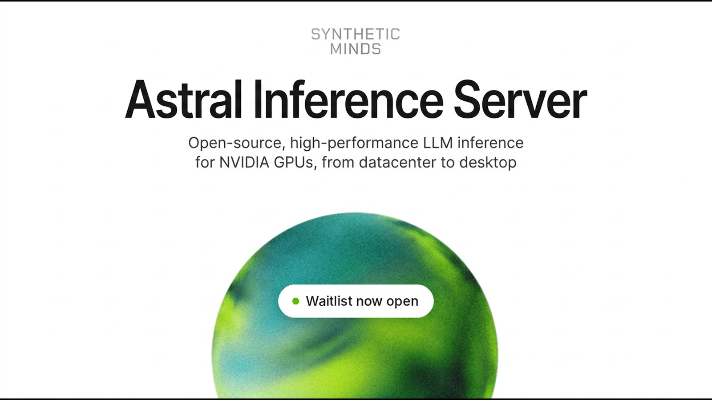

  

# Astral-Inference-Server

A high-throughput and memory-efficient inference and serving engine for LLMs on NVIDIA GPUs. A fast, CUDA-kernel-optimized, open-source production inference server, OpenAI-compatible. Runs Qwen 3.8, Inkling 2 Mini and more.

> **Status: in development.** Astral is not available to download yet. We aim to release the first version in December 2026.
>
> **Join the beta today:** https://www.syntheticmindslab.com/astral
