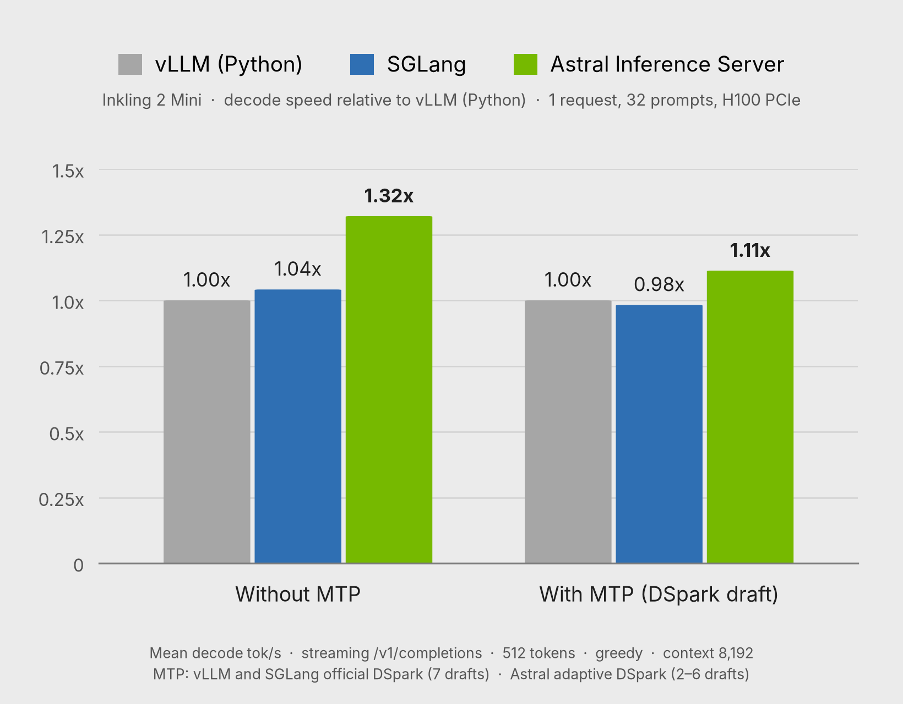

<!-- markdownlint-disable MD001 MD041 -->
<p align="center">
  <picture>
    <source media="(prefers-color-scheme: dark)" srcset="docs/assets/logos/synthetic-minds-logo-dark.png">
    
  </picture>
</p>

<h1 align="center">Astral Inference Server</h1>

<h3 align="center">
Fast, lean LLM inference and serving in Rust and CUDA
</h3>

<p align="center">
| <a href="https://www.syntheticmindslab.com/astral"><b>Website</b></a> | <a href="docs/README.md"><b>Documentation</b></a> | <a href="docs/getting_started/quickstart.md"><b>Quickstart</b></a> | <a href="docs/benchmarks/inkling2_mini.md"><b>Benchmarks</b></a> | <a href="docs/models/supported_models.md"><b>Supported Models</b></a> | <a href="CONTRIBUTING.md"><b>Contributing</b></a> |
</p>

> [!IMPORTANT]
> **About this fork.** `inkling-4090-engine` is an unofficial fork of [Astral Inference Server](https://github.com/syntheticminds-lab/Astral-Inference-Server) by Synthetic Minds LTD, ported to and validated on a single **GeForce RTX 4090 (sm_89)** for Inkling 2 Mini research. It is not affiliated with or endorsed by Synthetic Minds LTD; "Astral" is their trademark and is used here only to name the origin of the code. Crate and binary names are unchanged. Everything after the next section is the upstream README.

## This fork

Based on upstream `49a0a2b`. Changes so far:

- **RTX 4090 support:** `ArchProfile::Sm89` (F80 kernel family); build with `ASTRAL_CUDA_ARCHS=89`. See [RTX 4090](docs/hardware/rtx4090.md).
- **Bug fix (all GPUs):** synchronous uploads and fills now finish on the legacy stream before work starts on Astral's non-blocking streams. Before the fix, kernels could read half-copied inputs; on a PCIe Gen3 host the self-test failed 3–4 MXFP4 cases.
- **Comparison tools:** `astral dump-logits` writes Astral's log-probs in llama.cpp's `--kl-divergence-base` format; `astral cmp-prefill` reports where batched and token-by-token logits differ; [bench/llamacpp_compare](bench/llamacpp_compare/README.md) holds the analysis and serving-benchmark scripts.

On one RTX 4090 with the unsloth UD-Q4_K_XL GGUF, compared with llama.cpp b12751 on the same file ([details](docs/benchmarks/inkling2_mini_rtx4090.md)):

| | Astral (this fork) | llama.cpp | Speedup |
|---|---|---|---|
| Decode, no draft | 142.0 tok/s | 74.7 tok/s | 1.90× |
| Decode, DSpark draft | 206.3 tok/s | 90.5 tok/s (k = 3) | 2.28× |
| KL divergence vs llama.cpp, decode path | mean 0.0018, p99 0.023 | llama.cpp's own `-ub 512` vs `-ub 1`: 0.0020 / 0.028 | |

Open items: DSpark past about 114K tokens of context, and tuning the prefill (`mma3`) and MoE paths for sm_89. Issues and pull requests for this fork go to [this repository](https://github.com/lkyprogramer/inkling-4090-engine/issues); upstream issues belong upstream.

---

🔥 **New:** speculative decoding with the official Inkling 2 Mini DSpark draft and an adaptive draft length. On one H100, Astral decodes **32%** faster than vLLM without a draft and **11%** faster with one. See the [benchmarks](docs/benchmarks/inkling2_mini.md).

> **Status:** Version 2.5 is now open source and ready for testing.

---

## Support

Astral Inference Server is free and open source. If it is useful to you, you can help fund its development:

<a href="https://buymeacoffee.com/syntheticminds_lab"></a>

## About

Astral Inference Server is an inference engine and OpenAI-compatible server for large language models. The host side is Rust and every kernel is hand-written CUDA. It ships as a single binary with no Python runtime.

Astral Inference Server is developed by [Synthetic Minds LTD](#contact-us).

Astral is fast with:

- Hand-written CUDA kernels for every operator, verified layer by layer against a reference implementation
- CUDA graphs for every decode step and every speculative round, with **programmatic dependent launch** overlapping kernel launches on Hopper
- Low-precision weights end to end, with int8 **tensor-core GEMVs** for small batches and wgmma GEMMs for prefill
- Fused kernels: depth-mix + RMSNorm + quantisation, attention merge + output gate, router GEMV + top-k, batched loop controllers
- **Speculative decoding** with the model's own DSpark draft, GPU-side acceptance, short-conv state rollback and an **adaptive draft length**
- Grouped MoE kernels that read each used expert once per batch

Astral is flexible and easy to use with:

- An OpenAI-compatible API server: `/v1/completions`, `/v1/chat/completions`, streaming, stop strings, reasoning output and tool calls
- The checkpoint's own tokenizer and chat template, matching reference token ids exactly
- Loads native safetensors checkpoints directly, as well as GGUF files
- A bounded request queue with cancel-on-disconnect

Astral currently supports:

- Inkling 2 Mini, with or without its DSpark draft
- Qwen3.8-27B, from the command line

Support for more models is coming soon. Find the full list of supported models [here](docs/models/supported_models.md).

## Performance

Single-stream decode speed on an H100 PCIe 80 GB, averaged over 32 prompts and measured through each engine's OpenAI-compatible server:

<p align="center">
  
</p>

| Inkling 2 Mini | vLLM | SGLang | **Astral** |
|---|---|---|---|
| Without MTP | 130.2 tok/s | 135.6 tok/s | **172.0 tok/s (+32%)** |
| With MTP (DSpark draft) | 209.6 tok/s | 205.9 tok/s | **233.3 tok/s (+11%)** |

The methodology, per-prompt-set results and the vLLM Rust-frontend comparison are in the [benchmark report](docs/benchmarks/inkling2_mini.md).

## Getting Started

Build Astral from source (Linux, an NVIDIA driver with CUDA 12, `nvcc` 12.8+ and a recent stable Rust toolchain):

```bash
ASTRAL_CUDA_ARCHS=80,90a cargo build --release
./target/release/astral selftest      # kernel self-tests on your GPU
```

Serve Inkling 2 Mini with its DSpark draft, straight from the checkpoint directory:

```bash
./target/release/astral serve Inkling-2-Mini/
```

Visit our [documentation](docs/README.md) to learn more.

- [Installation](docs/getting_started/installation.md)
- [Quickstart](docs/getting_started/quickstart.md)
- [Supported Models](docs/models/supported_models.md)

## Editions

| | Developer | Enterprise |
|---|---|---|
| Licence | Apache-2.0, free | Commercial |
| Who it is for | Individuals, researchers, and organisations running it internally | Organisations deploying at scale |
| Deployment | One node (one GPU today; multiple GPUs on one node planned) | Multi-node and disaggregated serving |
| Engine, kernels, OpenAI-compatible server, speculative decoding | ✅ | ✅ |
| Custom deployments | — | ✅ |
| Support | Community (GitHub) | Commercial support |

This repository is the Developer edition. For Enterprise, visit [syntheticmindslab.com](https://www.syntheticmindslab.com/astral).

## Contributing

We welcome and value any contributions and collaborations.
Please check out [Contributing to Astral Inference Server](CONTRIBUTING.md) for how to get involved.

## Citation

If you use Astral Inference Server for your research, please cite it:

```bibtex
@software{astral2026,
  title  = {Astral Inference Server: Fast, Lean LLM Inference and Serving in Rust and CUDA},
  author = {{Synthetic Minds LTD}},
  year   = {2026},
  note   = {Version 0.0.1}
}
```

## Contact Us

<!-- --8<-- [start:contact-us] -->
- For technical questions and feature requests, please use GitHub [Issues](../../issues)
- For discussions with other users, please use GitHub [Discussions](../../discussions)
- For coordinated security disclosures, please follow our [security policy](SECURITY.md)
- For commercial licensing and the beta programme, please visit [syntheticmindslab.com](https://www.syntheticmindslab.com/astral)
<!-- --8<-- [end:contact-us] -->

## License

Copyright (c) 2026 Synthetic Minds LTD. Astral Inference Server is licensed under the Apache License 2.0 (`Apache-2.0`); see [LICENSE](LICENSE) and [NOTICE](NOTICE). "Astral" and "Astral Inference Server" are trademarks of Synthetic Minds LTD.
